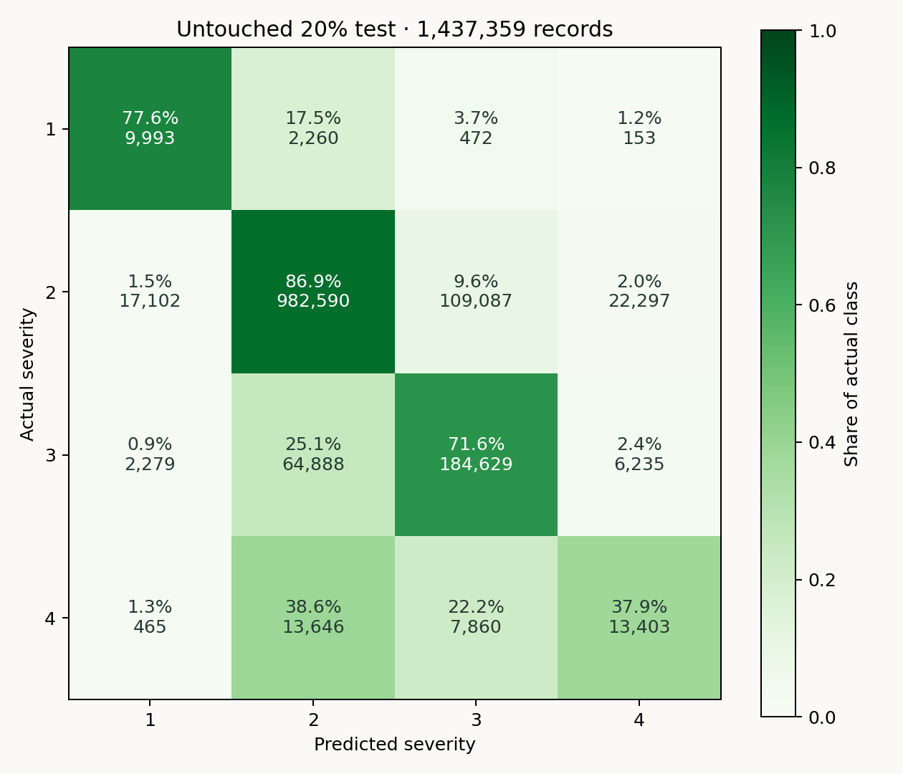
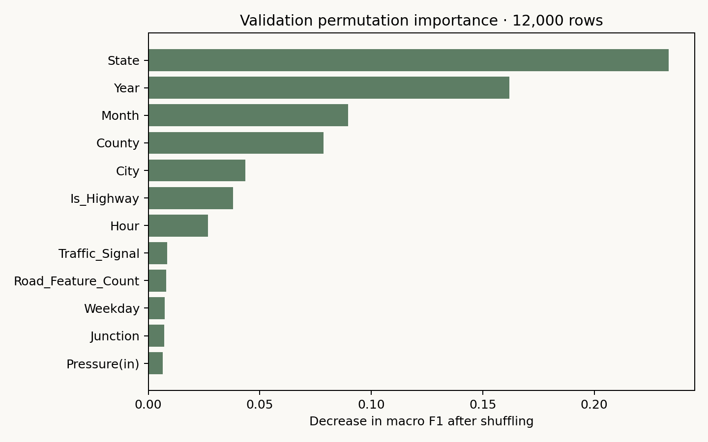

# Full-data severity classification results

The target is the original four-class traffic-impact Severity. It is not injury severity, delay duration, or accident occurrence probability.

Selected model: **LightGBM · deeper trees**, by validation macro F1. Test macro F1: **0.5922**; accuracy: **82.83%**; balanced accuracy: **68.48%**.

## Data and cleaning

The entire archive contains 7,728,394 records. 541,603 repeated exact time/coordinate events were removed, leaving 7,186,791. Final training used 5,749,432 rows and the untouched 20% test used 1,437,359 rows (ceiling rounding).

Raw weather observations after accident start were masked on 3,787,674 rows. Stale (>3 hours) or missing-timestamp weather was masked on 137,822 rows. Counts are before deduplication. Missing precipitation is not changed to zero. Optional missing location/light categories do not cause row deletion.

See [code audit](code_audit.md) and [machine-readable cleaning log](../outputs/reports/cleaning.json) for the corrections, physical thresholds, event-key policy and feature exclusions.

## Selection protocol

Seed 42. A stratified 80/20 split is created after deterministic cleaning and duplicate removal. Development is split again 80/20; capped stratified subsets of 600,000 fitting and 160,000 validation records are used for every candidate. Category vocabularies, numeric medians and scalers learn only from fitting data. Native categorical codes are flagged categorical for LightGBM. No outcome columns or Source are predictors.

Tree size, class weighting and early stopping are selected by validation macro F1; the best candidate is refitted on all development rows with its selected iteration count. Test evaluation follows once. This is a practical bounded search, not proof of a global optimum.

| Candidate | Validation macro F1 | Balanced accuracy | Severity 4 recall | Fit + validation seconds |
|---|---:|---:|---:|---:|
| Majority baseline | 0.2202 | 0.2500 | 0.0000 | 0.0 |
| Logistic regression | 0.3356 | 0.6132 | 0.5767 | 28.8 |
| LightGBM · natural | 0.5355 | 0.4873 | 0.1092 | 139.2 |
| LightGBM · moderate weights | 0.5636 | 0.6249 | 0.3085 | 135.5 |
| LightGBM · deeper trees | 0.5739 | 0.6109 | 0.2941 | 176.4 |
| LightGBM · balanced | 0.5270 | 0.6656 | 0.4418 | 312.0 |

## Untouched test evaluation

Majority baseline macro F1: 0.2202; accuracy: 78.69%. Selected model macro F1: 0.5922; weighted F1: 0.8358; macro OvR ROC-AUC: 0.9151; log loss: 0.4361.

| Severity | Precision | Recall | F1 | Support |
|---|---:|---:|---:|---:|
| 1 | 0.3349 | 0.7760 | 0.4679 | 12,878 |
| 2 | 0.9240 | 0.8687 | 0.8955 | 1,131,076 |
| 3 | 0.6113 | 0.7155 | 0.6593 | 258,031 |
| 4 | 0.3185 | 0.3789 | 0.3461 | 35,374 |

## Temporal robustness

A separate development-only diagnostic trains on up to 600,000 records before 2022 and evaluates on up to 160,000 records from 2022 onward. Its macro F1 is 0.3274. This is a different distribution and a smaller training sample than the final refit; it is not a second evaluation of the final model. It was not used for selection.

## Interpretation

Validation permutation importance uses one shuffle per feature on 12,000 validation records of the selected development model. Importance measures predictive reliance, not causal influence. Correlated predictors can share importance.

## Limitations

- Severity is traffic impact, not injury severity or accident probability.
- The random holdout estimates performance on the same historical distribution; nearby incidents may remain correlated.
- Training and test labels reflect provider conventions, even though Source is excluded as a feature.
- Weather availability is checked against start time; historical data ingestion timing and later road-map updates are unverified.
- Class-weighted model scores are not calibrated probabilities.
- Hyperparameters and iteration count were selected on development subsets; no claim of a globally optimal model.
- The data ends in March 2023 and does not establish current-road performance.

## Reproducibility

Source archive SHA-256: `9e1fe1bc00ab31432eb9cc3bb1dbf315f3aeaa17d61d61eb1f38c4c9a5fabf3f`.
Versions: `{"python": "3.14.0", "numpy": "2.4.4", "pandas": "3.0.2", "sklearn": "1.9.1", "lightgbm": "4.6.0"}`.

Artifacts: `data/processed/cleaned.parquet`, `data/processed/row_manifest.npz`, `data/splits/splits.npz`, `outputs/models/severity.joblib`, `data/predictions/test_predictions.parquet`, `data/predictions/test_predictions.csv.gz`, and `dashboard/dist/data/`.

Original source: [Moosavi et al.](https://arxiv.org/abs/1906.05409). [LightGBM documentation](https://lightgbm.readthedocs.io/en/stable/pythonapi/lightgbm.LGBMClassifier.html). The original `outputs/archive/midterm_report.pdf` describes earlier sample-based work and is preserved as a historical artifact.
